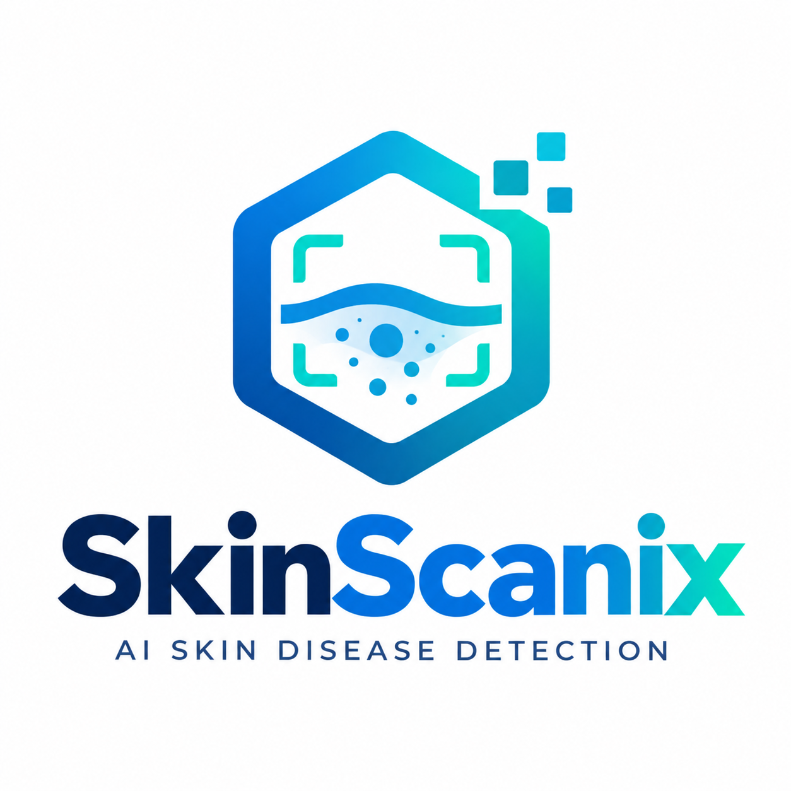
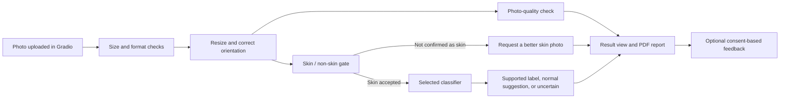

<p align="center">
  
</p>

<h1 align="center">SkinScanix</h1>
<p align="center"><strong>AI-assisted skin image screening — a college research prototype</strong></p>
<p align="center">
  Upload a photo · Review a model suggestion and image-quality feedback · Download a PDF report
</p>
<p align="center">
  <a href="https://ai-skin-disease-detection-system.onrender.com/"><strong>Open the live demo</strong></a>
  &nbsp;·&nbsp; <a href="#run-it-locally">Run locally</a>
  &nbsp;·&nbsp; <a href="#how-it-works">How it works</a>
  &nbsp;·&nbsp; <a href="#results-and-limitations">Results and limitations</a>
</p>

> **Educational use only.** SkinScanix is not a diagnostic device. A model output, including “Normal Skin” or a high confidence score, cannot confirm health, diagnose disease, or rule out a condition. Ask a qualified clinician about a concerning symptom.

## What this project does

SkinScanix is a browser-based application for exploring AI-assisted skin-photo analysis. A visitor uploads a photo, selects **Analyze image**, and sees a supported condition suggestion, a normal-skin suggestion, or an uncertain / unsuitable-image response. The application also checks basic photo quality and generates a branded PDF report. Feedback can be saved with consent for later human review.

**For someone trying it for the first time:** use a clear, well-lit image you have permission to share. Read the output as a model suggestion, not as medical advice. The public demo may take time to wake after inactivity.

| What you can do | What happens |
| --- | --- |
| Upload or capture a photo | The app prepares a bounded-size image before analysis. |
| Review the result | It shows a model label, confidence score, and image-quality notes. |
| Save a report | It generates an A4 PDF, normally one page. |
| Leave feedback | With explicit consent, the app stores a correction for supervised review. It does **not** learn instantly. |

## Which model is running?

| Where | Model | Output scope |
| --- | --- | --- |
| **Live Render site and default local run** | Pinned five-class ONNX classifier, plus a skin / non-skin gate | Acne Vulgaris, Eczema, Fungal Infection, Psoriasis, Normal Skin |
| **Optional local DINOv2 trial** | Pinned FP16 ONNX export of an external 23-label model, plus the same gate | “normal skin” and source categories; only the four supported condition groups are mapped to SkinScanix names. Other source categories return an uncertain result. |
| **Optional Flask API** | Uses the model selected by <code>SKINSCANIX_MODEL</code> | JSON prediction and report URL for programmatic clients |

The live site currently selects <code>SKINSCANIX_MODEL=current</code>. Setting <code>SKINSCANIX_MODEL=dinov2</code> is **local and experimental**; it does not change the live deployment. The DINOv2 model was tried on Render Free, but analysis exceeded the service's 512 MB memory limit, so the live service was restored to the five-class model. A separate GitHub repo or deletion of another Render service does not increase the RAM available to this service.

The DINOv2 model's 23 source labels are **not** 23 clinically verified conditions in this project. For example, labels outside the four supported disease groups are not silently presented as supported diagnoses.

## How it works



The app uses **Python**, **Gradio** for the public interface, **ONNX Runtime** and **LiteRT** for model inference, **OpenCV / Pillow / NumPy** for image handling and quality checks, and **ReportLab** for the PDF. A separate **Flask** entry point provides a JSON API. Render runs the Gradio app in a Python 3.12 Docker container.

Image preparation limits uploads to 10 MB, bounds decoded image dimensions, and avoids expanding very large phone photos before checks. The quality check reports blur and brightness; a good quality score does not establish that the model prediction is correct. Analyses are serialized to reduce memory spikes on the small host.

## Try the live demo

Open **[SkinScanix on Render](https://ai-skin-disease-detection-system.onrender.com/)**, upload an image, select **Analyze image**, and download the PDF if needed. The Render site uses the five-class model shown above. A slow first request can be a free-service cold start; a stalled analysis should not be interpreted as a medical result.

Use non-sensitive demonstration photos on the public service. Locally stored feedback and generated reports are not backed by a durable database on Render and can disappear on restart or redeploy.

## Run it locally

These commands assume **Windows PowerShell**, Git, and **Python 3.12 (64-bit)**. Run the commands in a new PowerShell window after installing Python. The first install needs internet access.

### Clone and start the default five-class demo

```powershell
git clone https://github.com/Vishal123-tech/AI-Skin-Disease-Detection-System.git
cd AI-Skin-Disease-Detection-System
py -3.12 -m venv .venv
.\.venv\Scripts\python.exe -m pip install gradio==6.25.0 onnxruntime==1.30.0 ai-edge-litert==2.2.0 opencv-python-headless==5.0.0.93 reportlab==5.0.0
$env:SKINSCANIX_MODEL = "current"
.\.venv\Scripts\python.exe .\run_local_ui.py --host 127.0.0.1 --port 7860
```

Open **http://127.0.0.1:7860/** on the same computer. Keep PowerShell open while using the app; press **Ctrl+C** to stop it. The local launcher does not require a Gemini API key.

**If Python is missing:** install the 64-bit Python 3.12 release from [python.org](https://www.python.org/downloads/), enable the Windows launcher during setup, open a new PowerShell window, and confirm `py -3.12 --version`. A missing `py -3.12` runtime prevents `.venv` from being created; installation commands that point into `.venv` will then fail too. Do not copy an existing `.venv` from another PC. Create it afresh on each computer.

**If the port is busy:** use another number, for example `--port 7866`, and open the corresponding address. If the page says *Demo mode — ML runtime unavailable*, check that the dependencies installed into the same `.venv` used to launch the app and that the model artifacts exist. The demo response is a runtime failure, not a classification. A Gemini key is not needed for either local model in this guide.

### Try the experimental DINOv2 model on the same PC

From the cloned project folder, using the environment installed above:

```powershell
.\.venv\Scripts\python.exe .\scripts\assemble_dinov2.py
$env:SKINSCANIX_MODEL = "dinov2"
.\.venv\Scripts\python.exe .\run_local_ui.py --host 127.0.0.1 --port 7866
```

Open **http://127.0.0.1:7866/**. The repository stores the model in two parts under <code>models/dinov2/</code> because the full ONNX file is larger than GitHub's normal per-file limit. The assembly script verifies its SHA-256 checksum before use; the assembled file is ignored by Git. If a port is occupied, change <code>--port</code> and use the matching browser address.

The original external PyTorch checkpoint is **not** included in this repository. The ONNX export matched its top class on 60 locally tested images, with small probability differences; this is an implementation parity check, not a clinical validation.

### Use a phone on the same Wi-Fi

Start the local Gradio app with <code>--host 0.0.0.0</code> and open your laptop's local IP address and selected port on the phone. Both devices must be on the same trusted network. This does not create a permanent public link. Browser camera access depends on browser permissions; file upload is an alternative.

For example, change the last launch command to:

```powershell
.\.venv\Scripts\python.exe .\run_local_ui.py --host 0.0.0.0 --port 7860
```

Find the laptop's IPv4 address with `ipconfig`. On the phone, open `http://YOUR-LAPTOP-IP:7860/`. If it does not connect, check that both devices use the same Wi-Fi and that Windows Firewall permits the Python process on that private network. `127.0.0.1` always means the device you are holding, so it will not reach your laptop from a phone.

## Optional API and hardware path

The public site is a **Gradio** interface. The repository also has a separate **Flask** service for JSON clients such as a Raspberry Pi uploader. It is not the same server as the Gradio page.

```powershell
.\.venv\Scripts\python.exe -m pip install Flask requests
$env:SKINSCANIX_MODEL = "current"
.\.venv\Scripts\python.exe -m skinscanix.app --host 127.0.0.1 --port 5000
```

To test the Flask endpoint from another PowerShell window, replace the image path with a photo you are allowed to use:

```powershell
curl.exe -F "image=@C:\path\to\example.jpg" http://127.0.0.1:5000/api/predict
```

<code>skinscanix/pi_capture.py</code> can capture through Picamera2, with an OpenCV camera fallback, then POST to a configured <code>SERVER_URL</code>. For a Pi on your network, the Flask server must bind to a reachable interface and <code>SERVER_URL</code> must point to that computer's LAN address. The disease classifier runs on the server, not on the Pi. An ESP32 plus USB webcam circuit is a **proposed hardware design**, not a completed integration in this repository.

## Feedback, training, and data

- Feedback requires consent before copying an image to <code>feedback/images/</code> and writing a record to <code>feedback/feedback.jsonl</code>. Those paths are ignored by Git.
- The “Check retraining status” control does not update weights. Automatic one-click training was paused after a regression; model changes require reviewed labels, a separate training run, evaluation, and a deliberate release.
- Training and experiment scripts are under <code>skinscanix/</code> and <code>scripts/</code>. Colab notebooks and methodology notes are under <code>docs/</code>. They document research workflows rather than a continuously retraining production system.
- Training datasets, consent records, uploaded photos, feedback images, reports, credentials, and the original external PyTorch weights are **not** published in this GitHub repository. Do not infer a label or permission from an image merely because it was found online.
- The experimental DINOv2 export comes from the [external model card](https://huggingface.co/shindevaishnavi304/dinov2-finetuned-skin-disease), which lists Apache-2.0 for that model. The [SCIN dataset repository](https://github.com/google-research-datasets/scin) documents one historical data source. Their terms and limitations are separate from this repository's code.

### How to improve or retrain a model

The repository includes training code, but a fresh clone does **not** include the labelled training images. There is no command that can safely learn from arbitrary uploaded photos without confirmed labels. For a new candidate model:

1. Assemble a permitted dataset with clear provenance and verified labels. Keep uncertain images out of confirmed *Normal Skin* and disease categories.
2. Separate people or lesions across training, validation, and untouched test groups. Different views of the same hand or lesion must stay in the same group.
3. Install the training dependencies in a separate environment using [<code>requirements/requirements-train.txt</code>](requirements/requirements-train.txt), and read the [training notes](docs/CANDIDATE_TRAINING_20260920.md). The training workload can require substantially more memory and time than inference.
4. Train into a **new** candidate directory with the appropriate script, such as [<code>skinscanix/train_candidate.py</code>](skinscanix/train_candidate.py). Do not overwrite the live artifact while experimenting.
5. Compare against the current model on the **same untouched images**. Report normal-to-disease errors, disease-to-normal errors, per-class precision/recall and an uncertainty analysis. Test the complete gate → classifier → report path as well as the raw classifier.
6. Release only if the candidate improves the intended use without unacceptable new mistakes. Pin the artifact hash, record the test protocol, and then change deployment configuration deliberately.

The raw DINOv2 comparison below is an example of why improvement on one group is not enough to justify replacing the live model.

## Results and limitations

A local, provisional-label comparison assessed **raw classifier outputs**, before the complete UI/gate/rejection pipeline. It was not an independent clinical accuracy study:

| Same internal test images | Five-class model | Experimental DINOv2 |
| --- | ---: | ---: |
| Normal images assigned Normal | 65 / 75 | 57 / 75 |
| Normal images assigned any disease | 10 / 75 | 18 / 75 |
| Disease images assigned Normal | 13 / 268 | 21 / 268 |

On one separate 19-image healthy-source group, DINOv2 assigned 17 Normal versus 8 for the five-class model. That small single-source group does not overturn the worse internal-test counts. Source labels were provisional, and the model comparison did not measure patient-level clinical performance, skin-tone equity, calibration, or safe disease triage. **Do not quote one overall “accuracy” number for the project.** Read the [comparison and method](docs/EXTERNAL_DINOV2_TRIAL_20261113.md) and the [normal-skin release audit](docs/NORMAL_SKIN_RELEASE_20261005.md) before making performance claims.

The model can mistake healthy-looking skin for eczema or another condition and can also call a diseased image normal. “Confidence” is the model's score among its labels, not the probability that a person has or lacks disease. Unfamiliar conditions, poor framing, and limited training data remain major sources of error.

## Repository guide

| Path | Purpose |
| --- | --- |
| <code>skinscanix/gradio_app.py</code>, <code>run_local_ui.py</code> | Website UI and private local launcher |
| <code>skinscanix/predictor.py</code>, <code>models/</code> | Model routing, class mapping, pinned artifacts and gate |
| <code>skinscanix/quality.py</code>, <code>skinscanix/upload_preparation.py</code> | Photo checks and bounded decoding |
| <code>skinscanix/report.py</code>, <code>static/</code> | PDF generation and visual assets |
| <code>skinscanix/app.py</code>, <code>skinscanix/pi_capture.py</code> | Optional Flask API and Raspberry Pi uploader |
| <code>scripts/</code>, <code>docs/</code>, <code>tests/</code> | Model assembly, experiments, technical notes and tests |
| <code>Dockerfile</code>, <code>render.yaml</code> | Hosted app configuration |

For deeper technical detail, start with the [DINOv2 comparison](docs/EXTERNAL_DINOV2_TRIAL_20261113.md), [feedback workflow](docs/FEEDBACK_LOOP.md), [Render memory notes](docs/RENDER_MEMORY_FIX.md), and [Colab training guide](docs/COLAB_TRAINING.md). Some older research notes describe earlier checkpoints; the pinned runtime manifests in <code>models/</code> define the current selectable artifacts.

## Deployment and project scope

The checked-in Dockerfile installs the deployment dependencies, assembles the optional DINOv2 artifact, and launches Gradio. It selects <code>SKINSCANIX_MODEL=current</code> by default. Render Free provides 512 MB RAM per service ([Render compute plans](https://render.com/docs/compute-plans)); the larger DINOv2 trial previously exceeded that limit during analysis. Deleting a separate Render service does not add memory to SkinScanix.

No standalone code <code>LICENSE</code> file is included here. Public GitHub access alone does not grant permission to reuse the code or datasets. This is an educational prototype and an engineering demonstration, with substantial validation and clinical-governance work remaining before any real health use.
